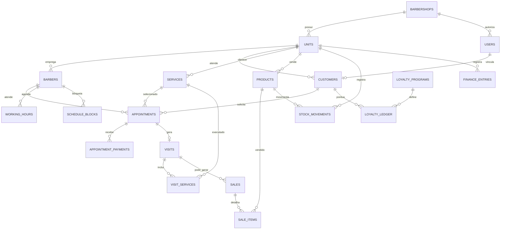

# Fase 1 — modelo de dados

Banco-alvo: Cloudflare D1 / SQLite. Execute a migration em `db/migrations/0001_initial.sql` com Wrangler. As datas são ISO-8601; instantes são UTC. Valores monetários são inteiros em centavos para evitar erro de ponto flutuante.

## Diagrama entidade-relacionamento



## Regras do modelo

- `barbershop_id` identifica o negócio; `unit_id` delimita dados operacionais por unidade. O primeiro uso terá uma unidade e um barbeiro.
- `users` é a identidade interna e seu papel (`ADMIN`/`CLIENT`). O provedor de autenticação será definido na fase de implementação; não haverá senha em texto claro no D1.
- Cliente avulso é uma linha em `customers` sem `user_id`; cadastro fidelizado pode vincular a identidade e consentimento.
- Agendamento guarda snapshots de preço e duração para que mudanças futuras no catálogo não reescrevam o histórico.
- Pagamentos são registros separados e podem ser parciais; o status de pagamento não depende de integração com adquirente.
- Atendimento concluído gera `visits`, que alimenta fidelidade e indicadores. Receita pode ser lançada separadamente para permitir composição de serviço e venda.
- Venda e itens de venda guardam preço e custo unitário no momento da transação. Estoque é auditável via movimentos.
- `finance_entries` centraliza receitas/custos e ligações opcionais a venda, atendimento ou compra. Valores positivos com tipo `INCOME`/`EXPENSE`.
- A aplicação deve usar transações D1 para gravar venda, itens, baixa de estoque e lançamento financeiro como uma operação atômica.

## Autorização (substituto da RLS)

Toda rota autenticada deve validar o token/sessão no Worker. O `ADMIN` só acessa barbearias/unidades onde sua associação está ativa. O `CLIENT` só consulta/edita seu próprio perfil e seus agendamentos, e não pode escolher outro `customer_id`. Rotas públicas de disponibilidade retornam apenas slots livres e dados mínimos. Escrita de pagamento, estoque, caixa e confirmação de agenda é restrita ao `ADMIN`. Não aceitar `barbershop_id`, `unit_id`, papel ou cliente como autoridade sem conferir a associação no servidor.

## Aplicação

```sh
npm install
npx wrangler d1 migrations apply barber-bar-db --local
npx wrangler d1 execute barber-bar-db --local --file=db/seed/0001_demo.sql
```

Os comandos supõem que o binding `barber-bar-db` será declarado no `wrangler.toml` da aplicação, a ser criado na Fase 2. Para produção, usar `--remote` apenas após validar a migration em local/preview e confirmar o banco de destino.

O seed cria registros fictícios e pode ser reaplicado somente em banco limpo. É para desenvolvimento, nunca para produção.

